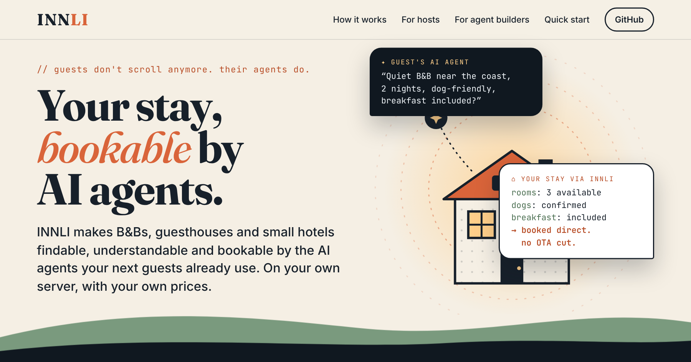

<div align="center">

# INNLI

**Your stay, bookable by AI agents.**

Free, open-source software that makes B&Bs, guesthouses and small hotels findable, understandable and bookable by AI agents.<br>
Self-hosted. Your own prices. No commission.

[](https://github.com/laaielichter/innli-stays/actions/workflows/ci.yml)
[](https://www.npmjs.com/package/innli-stays)
[](LICENSE)
[](docs/agent-integration.md)

[**Website**](https://laaielichter.github.io/innli-stays/) · [Quick start](#quick-start) · [For agent builders](docs/agent-integration.md) · [Owner guide](docs/owner-guide.md) · [Changelog](CHANGELOG.md) · [Nederlands](README.nl.md)

<a href="https://laaielichter.github.io/innli-stays/"></a>

</div>

> Guests don't scroll anymore. Their agents do. INNLI makes your accommodation ready for them, with your own website, prices and booking system.

INNLI is not a chatbot and not another hotel system. It has four parts:
- an **accommodation passport** that the owner checks and confirms;
- **one MCP connection** through which AI agents search that passport, ask for prices and availability, and prepare a booking;
- a **WordPress plugin**;
- a **dashboard** for the owner.

Being found, being understood by an agent and actually getting booked are three different things. INNLI covers the whole route.

**Open source (AGPL-3.0), and free to run yourself.** The B&B runs INNLI itself (Raspberry Pi, own PC or a server). The **INNLI guide** is one free address for agents that relays to all self-hosted properties. INNLI takes no commission on bookings. A commercial licence is available for companies: see [Using INNLI](#using-innli).


## What it does

| Part | What it does |
|---|---|
| **Accommodation passport** | About 40 concrete facts: enclosed garden, bed length, steps to the room, tourist tax… Every fact has a status (confirmed / not confirmed / unknown), a source, evidence and a check date. Unknown stays unknown. After a year INNLI asks the owner to check it again. |
| **Agent connection (MCP + REST)** | 20 tools in seven groups: search and compare, availability, price, booking, contact with the host, and stay wishes (see the detailed list below). A core profile offers 8 of them, with brief answers. The same tools are available over REST with an OpenAPI 3.1 description. |
| **Honest prices** | An itemised total including mandatory fees, discounts and tourist tax, with a validity period. If a mandatory cost is unknown, the result says `totalIncludesAllMandatoryCosts: false` instead of showing a price that is too low. |
| **Calendars and booking systems** | Four ways to handle availability: <br>• **Live API:** a booking system checked live, with a direct booking link.<br>• **iCal:** calendars from Airbnb, Booking.com or Google Calendar, leading to an availability request.<br>• **Room calendar:** the owner opens and closes nights in INNLI.<br>• **None:** requests only. |
| **Reliable booking** | <br>• Rooms are held during a request, with automatic expiry.<br>• Instant booking within the owner's rules.<br>• Deposits through the owner's own payment link or bank details.<br>• Cancellation with the guest's consent.<br>• A signed booking record.<br>• A double-booking guard against other channels. |
| **Stay page** | A public page per property, with rooms, confirmed facts, schema.org data, an availability calendar, live prices and a request form. It can be embedded on the owner's site. |
| **Languages** | Guests: English, Dutch, German and French. They see the stay page, e-mails and status pages in their own language, with hreflang for search engines.<br>Agents: English.<br>Owners: an English or Dutch dashboard, e-mails and monthly report. |
| **Currencies** | Each property prices in its own currency: EUR, GBP, CHF, DKK, SEK, NOK, PLN, CZK, HUF, RON, ISK, USD, CAD, AUD or NZD. INNLI never converts; a budget is only compared within one currency. |
| **Insights** | What agents search for in the owner's area, how often the property was shown, and which unknown facts cost guests. Also a funnel from agent request to click-through to confirmed booking, with each step counted separately. |
| **Findability check** | <br>• robots.txt per crawler, keeping **search** crawlers and **training** crawlers apart.<br>• noindex, title, sitemap, room pages, visible prices and conditions, schema.org.<br>• Consistency with the passport.<br>It never promises a ranking. |
| **WordPress plugin** | <br>• schema.org data from confirmed facts.<br>• The same facts shown visibly on the page.<br>• AI crawler settings.<br>• A crawler visit counter.<br>• Booking reports and the request form.<br>In English, with a Dutch translation. |
| **Hotels and busy properties** | Room types with several rooms (availability counted per night, stop-sell), rate plans (non-refundable, with breakfast), 15-minute holds, changes without cancelling first, staff keys (reception/manager), signed webhooks to a PMS or channel manager, and hotel licence packages. Measured: availability for a 300-room hotel with 10,000 bookings in ~1 ms. See [docs/hotels.md](docs/hotels.md). |
| **Reply guard** ([docs/reply-guard.md](docs/reply-guard.md)) | `check_reply` checks what an agent is about to tell the guest against what the stay actually returned: a booking that is not one yet, an amount the stay never gave, an unconfirmed fact told as certain. No language model, ten languages. `npm run grade` scores a whole conversation, as a test of a booking agent. |
| **ACP checkout and card guarantees** ([docs/acp.md](docs/acp.md)) | Checkout sessions in the Agentic Commerce Protocol of OpenAI and Stripe, at `/acp`. An item is a quote or a stay written out in its id. Optionally a card guarantee on the property's own Stripe account: authorised at checkout, captured only when the host confirms, released otherwise. |
| **New in 2.1: know your agent, protected holds, UCP** ([docs/agents-2.1.md](docs/agents-2.1.md)) | What we found missing elsewhere, built in:<br>• *agent identity*: platforms that sign their requests (Web Bot Auth, RFC 9421) are recognised without an account, get their own rate limit, and are named in the signed booking record;<br>• *protected holds*: a limit on open requests per agent and per guest, so a script cannot block a property's rooms;<br>• *UCP lodging booking sessions* (draft) at `/ucp/v1`, with the profile at `/.well-known/ucp`;<br>• an `Idempotency-Key` header, so a retry never books twice;<br>• `cancellation.refundability` on every quote;<br>• per agent in the dashboard: what became a booking and what expired;<br>• identity passed on, signed, through the INNLI guide;<br>• `npx innli-conformance <address>`: 14 read-only checks of any installation. |
| **New in 2.0: agents and stays find each other** ([docs/agents-2.0.md](docs/agents-2.0.md)) | Ten problems from research, solved:<br>• *stay wishes*: agents leave an anonymous wish, and hosts answer with an offer from the dashboard, optionally with a discount;<br>• a *core profile* and brief answers: ~49% less context per turn and ~70% smaller answers;<br>• `nextActions` with prefilled arguments and `freshness` on every answer;<br>• typed errors with `retryable` and `hint`, plus RateLimit headers;<br>• consent with a hash over the terms;<br>• website verification (automatic with the WordPress plugin), a trust block and a signed passport;<br>• a guard against hidden instructions in text;<br>• a time budget for search;<br>• an agent card, MCP server card, `llms.txt` and a Claude plugin ([agent-kit](agent-kit/README.md)). |
| **New in 1.1** | Paid options (bikes, packed lunch, late check-out), private discount codes, arrival weekdays and a one-night supplement, calculated cancellation costs, alternatives when full, honest scarcity ("2 rooms left"), reviews per aspect, house rules and sustainability as facts, searching for "a long weekend" and a price per night, photo upload with checks for vague descriptions, a booking calendar (iCal), CSV export, occupancy and revenue per channel, automatic backups and restore, a Beds24 connection, OAuth 2.1 for agent platforms and signed status callbacks. See [CHANGELOG.md](CHANGELOG.nl.md). |
| **Answer assistant** | Answers guest questions straight away in four languages, only from the owner's confirmed details and FAQ; no language model, nothing made up. What is unknown goes to the owner, with a draft of what is already known. Also as *Ask us* on the stay page. |
| **Guide (and optional keys)** | The INNLI guide lists every installation for free, after checking it really runs at its address. Anyone running their own guide with `GIDS_LICENTIE_VEREIST=1` can issue offline-verifiable Ed25519 keys, for example for a closed network of stays. |

## Agent tools

- **Search and compare:**
  - `search_stays`, with flexible dates, "near the station", groups over 2–3 rooms, and a budget in a given currency;
  - `compare_stays`;
  - `get_stay_details`, with photos, places nearby, FAQ, reviews and the description in the guest's language.
- **Availability:** `check_availability`, `find_available_dates`, `get_availability_calendar`.
- **Price:** `get_quote`, with several rooms, rate plans and a 15-minute hold.
- **Booking:** `prepare_booking`, `request_booking` (with the guest's consent; for groups all or nothing), `modify_request`, `cancel_request`, `join_waitlist`.
- **Honest replies:** `check_reply` (checks your draft against what the stay said).
- **Contact:** `answer_question` (answer assistant), `ask_host`, `report_data_issue`, `check_status` (with a signed booking record).
- **Stay wishes:** `post_stay_wish`, `get_wish_offers`, `withdraw_stay_wish`.

Details: [docs/agent-integration.md](docs/agent-integration.md).

## Quick start

Requires Node.js 22.18 or newer. TypeScript runs directly, without a build step.

```bash
npm install --omit=dev
INNLI_LANG=en npm start      # shows an installation code; open http://localhost:3000/dashboard/
```

The browser wizard asks for the installation code, your name, the language of your texts and your first room. It then gives you your owner key. Next: [docs/owner-guide.md](docs/owner-guide.md). To make INNLI reachable for agents 24/7 at the lowest cost, see [docs/hosting.md](docs/hosting.md).

**Try it with sample properties.** Seven stays across Europe:
- Tuscany, Provence, the Black Forest, Bruges, Tyrol, the Douro and Kerry;
- live and synced calendars, confirmed, unconfirmed and unknown facts, reviews and a FAQ.
- plus a 48-room city hotel in Haarlem with room types, rate plans and the answer assistant (see [docs/hotels.md](docs/hotels.md)).

```bash
npm install
npm run demo:intl            # http://localhost:3000 — owner keys in data/demo-credentials.json
```

Connect an agent:

```bash
claude mcp add --transport http innli http://localhost:3000/mcp
npx @modelcontextprotocol/inspector     # or: Streamable HTTP → http://localhost:3000/mcp
```

Then ask, for example: *"Find a quiet farm stay in Tuscany for three nights in May with an enclosed garden for my dog and a ground-floor room with a walk-in shower."*

## Configuration

| Variable | Default | Meaning |
|---|---|---|
| `PORT` / `HOST` | `3000` / `0.0.0.0` | |
| `INNLI_PUBLIC_URL` | `http://localhost:$PORT` | Base for booking links and pages |
| `INNLI_LANG` | `nl` | Installation language: console, e-mails to owners without a language, pages without a browser preference (`nl`, `en`, `de`, `fr`) |
| `INNLI_AGENT_LANG` | `en` | Language of agent-facing text |
| `INNLI_DATA` | `data/innli.json` | Data file. Requests, events and so on sit next to it in `innli.*.jsonl`. Back up the whole folder. |
| `INNLI_ADMIN_KEY` | – | Required for `/api/admin` |
| `INNLI_REQUIRE_AGENT_KEY` | – | `1` = only agents with a key may use the MCP connection |
| `INNLI_DEMO` | – | `1` = Dutch sample data; `intl` = European sample data |
| `INNLI_ALLOW_PRIVATE_FETCH` | – | `1` = a booking system or calendar on the local network may be called |
| `INNLI_GIDS_URL` | – | Address of the INNLI guide; the installation registers there (at start-up and every 12 hours) |
| `INNLI_SOURCE_URL` | – | Where the source of this version is (AGPL). If you modified INNLI and run it online, link to your public code here; it appears in `/health` and `/.well-known/innli.json` |
| `INNLI_SMTP_URL` / `INNLI_MAIL_FROM` | – | E-mail through the owner's own mailbox |
| `INNLI_BEWAARTERMIJN_DAGEN` | `180` | Days after the stay before guest data is deleted (minimum 30) |
| `INNLI_BACKUP_DIR` | – | Folder outside the data folder for a daily automatic backup (USB disk, NAS, synced folder) |
| `INNLI_BACKUP_KEEP` | `14` | Number of daily backups kept |
| `INNLI_UCP_VERSION` | `2026-08-25` | Version named in the UCP profile and responses; the lodging capability is a draft |
| `INNLI_TRUST_PROXY` | `1` | Reverse proxies or tunnels in front whose `X-Forwarded-*` headers are trusted. Set `0` when the installation is reachable directly from the internet, or callers can pretend to be another address |
| `INNLI_STRIPE_SECRET_KEY` / `INNLI_STRIPE_ACCOUNT` | – | Experimental: the property's own Stripe key, to take card guarantees from agent platforms over ACP. Without it the guest pays the property directly. See [docs/acp.md](docs/acp.md) |

Command line: `npm run innli -- list`, `npm run innli -- new-key <id>`, `npm run innli -- agent "Name"`, `npm run innli -- license <key>`. Stop the server first.

## Development

```bash
npm test                     # unit and end-to-end tests
npm run typecheck
npm run lint:php             # WordPress plugin
npm run conformance -- http://localhost:3000   # 14 read-only checks of what agents rely on
npm run bench                # performance (300 properties, 200,000 events)
npm run pakket -- --concept  # download package (zip) in dist/
```

## Principles in the code

1. **Unknown stays unknown.** Agents get an explicit list of unknown facts. An unconfirmed "no" does not count as a reliable no.
2. **Only the owner confirms.** Imports and connections produce suggestions; they never overwrite a confirmed fact.
3. **No booking promise on stale data.** A direct booking link only comes with live-checked availability; iCal leads to a request.
4. **Nothing is booked without the owner.** `booked: true` only after acceptance (or instant booking within the owner's rules). Guest data stays on the B&B's own installation and is deleted after the retention period.
5. **Measure what is real.** Crawler visits are not guests. Agent requests, click-throughs and confirmed bookings are counted separately.
6. **No ranking promises.** The findability check is about technical accessibility and data quality.
7. **No hidden conversion.** Prices stay in the property's currency; agents are told the currency, never an estimate.

## Documentation

- [docs/demo.md](docs/demo.md): watch an AI agent book a stay, or do it yourself in five minutes
- [docs/install.md](docs/install.md): installing (zip or Docker)
- [docs/owner-guide.md](docs/owner-guide.md): guide for the B&B owner
- [docs/hotels.md](docs/hotels.md): for hotels: room types, rate plans, answer assistant, staff, webhooks to your PMS
- [docs/hosting.md](docs/hosting.md): running locally or online, costs, tunnel, connecting calendars
- [docs/agent-integration.md](docs/agent-integration.md): for builders of travel agents
- [docs/reply-guard.md](docs/reply-guard.md): `check_reply`, the guard against saying more than the stay said, and grading a conversation
- [docs/acp.md](docs/acp.md): ACP checkout sessions and card guarantees
- [docs/agents-2.1.md](docs/agents-2.1.md): what other projects and standards offer agents, the five biggest open problems, and how 2.1 solves them
- [docs/agents-2.0.md](docs/agents-2.0.md): the ten biggest problems between agents and accommodations, and how 2.0 solves them
- [agent-kit/](agent-kit/README.md): Claude plugin, MCP registry entry and what agents get in 2.0

- [docs/agent-features.md](docs/agent-features.md): every agent feature in detail
- [docs/connector-contract.md](docs/connector-contract.md): the contract for connecting a booking system
- [docs/performance.md](docs/performance.md): measured performance
- [docs/research-booking-problems.md](docs/research-booking-problems.md): what goes wrong when AI agents book, with sources

- [SECURITY.md](SECURITY.md): reporting a vulnerability, what INNLI protects, and running it safely

In Dutch: [README.nl.md](README.nl.md) and [docs/nl/](docs/nl/).

## Research

INNLI is an **open research project**: how can AI agents find and book small independent accommodations honestly, safely and efficiently, without an intermediary? The research questions, methods and first results are in [research/](research/README.md). Everything is reproducible with `npm run measure` and `npm run research:injection`. It is self-funded. To cite INNLI, see [CITATION.cff](CITATION.cff).

## Using INNLI

| | For whom | Cost |
|---|---|---|
| **Run it yourself** | Hosts and developers who run INNLI on their own computer or server. Everything in this repository, no limits. | Free (AGPL-3.0) |
| **Commercial licence** | Platforms, PMS and channel-manager vendors that build INNLI into a product without publishing their own code. The larger licence includes INNLI Pro: all-or-nothing trips across several stays. | From € 2,500 a year, fixed prices: [COMMERCIAL.md](COMMERCIAL.md) |

INNLI takes no commission on bookings, does not sell data of guests or hosts, and has no paid places in search results.

Companies that want to take the whole project further: see [For companies](docs/for-companies.md).

## Support INNLI

Does it help your stay, or are you building an agent with it?
- **Star it** on GitHub, so others find INNLI.
- **Contribute:** report bugs, translate, or build a connection to a booking system.

## Licence

- **The program:** [GNU AGPL-3.0](LICENSE). Free to use and modify, also for your own business. If you offer a modified version over a network, you share that version's source code.
- **A commercial licence** is available for building INNLI into your own product without sharing your code. See [COMMERCIAL.md](COMMERCIAL.md).
- **The agent kit:** [MIT](agent-kit/LICENSE), so agents connect without conditions.
- **The WordPress plugin:** GPL-2.0-or-later.
- **Contributions** fall under the [contributor agreement](CLA.md).
- **The name:** "INNLI" and the logo are not part of these licences. See [TRADEMARK.md](TRADEMARK.md).
